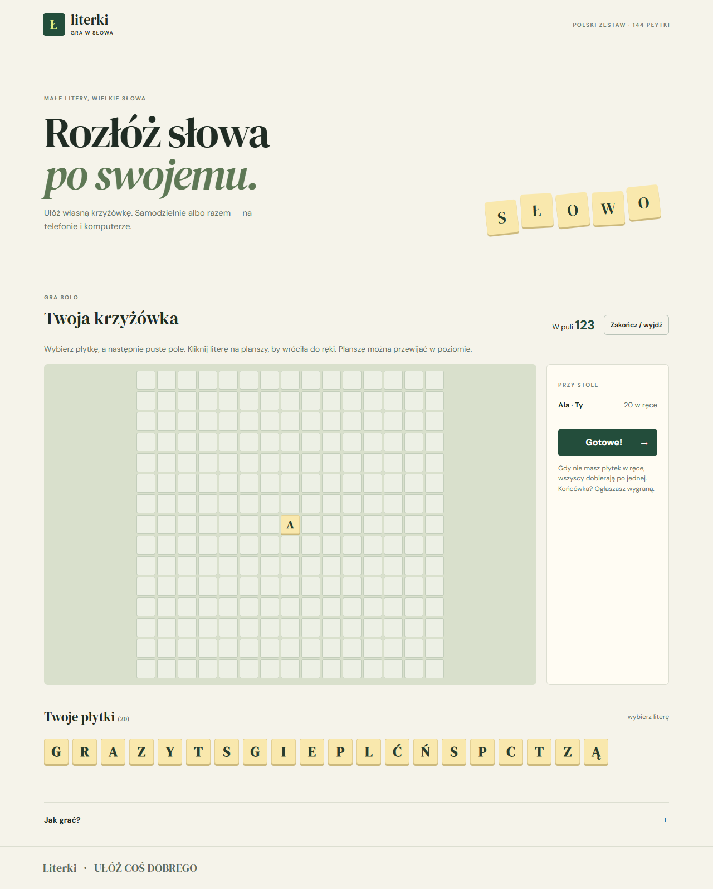
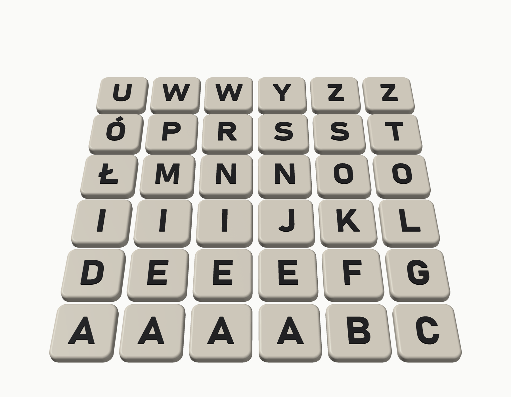

# 🔤 Bananagram PL

Polska gra w układanie słów i zestaw 144 płytek do wydrukowania w 3D. Projekt jest niezależny i inspirowany grą Bananagrams.

**[🎮 Zagraj solo](https://itstomekk.github.io/bananagram-pl/)** · **[🖨️ Pliki i instrukcja 3D](3d/)** · **[📖 Zasady](docs/README.md)** · **[🛠️ Dla twórców](DEVELOPMENT.md)**

## 🎮 Ułóż coś dobrego

Losujesz litery i układasz z nich krzyżówkę. Gra działa na telefonie i komputerze, a tryb solo zapisuje postęp w przeglądarce.

**Gra ze znajomymi:** prototyp pokoi dla 2–4 graczy działa na własnym serwerze Node.js. Sama strona GitHub Pages obsługuje tylko solo; internetowy serwer pokoi nie jest jeszcze dostępny. Gra nie sprawdza słów w słowniku ani nie pokazuje plansz przeciwników. [Szczegóły i zasady](docs/README.md).

## 🖨️ Wydrukuj własne płytki

W folderze [`3d/`](3d/) znajdziesz cztery płyty STL z wypukłymi literami, proponowany rozkład liter i instrukcję dla **Bambu Lab A1 z PLA**. Obrazek powyżej jest wizualizacją, nie zdjęciem wydruku.

STL trzeba pociąć w Bambu Studio. Modele nie zostały jeszcze pocięte ani przetestowane na drukarce, dlatego zacznij od małej próbki. Rozkład jest autorską propozycją, a nie oficjalnym rozkładem Bananagrams.

## 💬 Pomóż nam testować

Znalazłeś błąd albo wydrukowałeś płytki? [Otwórz zgłoszenie](https://github.com/itstomekk/bananagram-pl/issues) i opisz urządzenie, ustawienia oraz swoje doświadczenia. To wczesna wersja i zasady mogą się jeszcze zmienić.

## ℹ️ Niezależny projekt

Bananagrams to nazwa handlowa należąca do jej właściciela. Projekt nie jest oficjalną wersją gry ani nie jest z nią powiązany. Zasady redystrybucji poszczególnych zasobów, w tym kształtów liter modeli, wymagają osobnej weryfikacji; nie zakładamy otwartej licencji.
